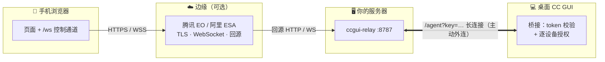

<div align="center">

# CC GUI Relay

**让手机在外网访问本机 CC GUI —— 无需在电脑上开放任何入站端口**

一个中继 · 两种部署（Cloudflare Worker / 自托管 Node）· 协议完全一致，客户端零改动

[](LICENSE)
[](package.json)
[](wrangler.toml)
[](test)

</div>

---

## 目录

- [它是怎么工作的](#它是怎么工作的)
- [快速开始](#快速开始)
  - [方式一：Cloudflare Worker](#方式一cloudflare-worker)
  - [方式二：自托管 Node 服务器](#方式二自托管-node-服务器)
  - [边缘回源配置（EO / ESA）](#边缘回源配置eo--esa)
- [配置项](#配置项)
- [手机配对](#手机配对)
- [排障指南](#排障指南)
  - [三步定位法](#三步定位法)
  - [事故档案：EO 缓存了截断的 JS](#事故档案eo-缓存了截断的-js)
- [开发与测试](#开发与测试)
- [目录结构](#目录结构)
- [注意事项](#注意事项)

---

## 它是怎么工作的

电脑上的 CC GUI **主动向外**连接中继并保持一条 WebSocket 长连接；手机的所有请求都复用这条连接回到桌面端。因此：

- **零入站端口**——电脑不开任何防火墙洞；
- **鉴权完全在桌面端**——URL 里的 token 与逐设备授权都由 CC GUI 的桥接决定，中继只校验 `RELAY_KEY` 并搬运字节；
- **自动恢复**——桌面端断线或中继重启后，桌面端按现有逻辑自动重连，手机侧无需操作。



---

## 快速开始

### 方式一：Cloudflare Worker

```bash
npx wrangler login                    # 浏览器授权一次
npx wrangler secret put RELAY_KEY     # 按提示粘贴密钥（不进 wrangler.toml）
npx wrangler deploy                   # 输出 https://ccgui-relay.<你的子域>.workers.dev
```

CC GUI → 设置 → 远程访问 → 外网访问：中转地址填上面的 URL，中转密钥填你设置的 `RELAY_KEY`，点「连接中转」。

### 方式二：自托管 Node 服务器

**前置**：一台 Linux 服务器、Node ≥ 18.17（或 Docker）、一个能开放 TCP 的端口。

**Docker Compose（推荐）**：

```bash
git clone https://gitee.com/ShiJiQuanTang/ccgui-relay-docker.git
cd ccgui-relay-docker
echo "RELAY_KEY=<你的密钥>" > .env
docker compose up -d

docker compose logs -f     # 看日志
docker compose down        # 停止
```

**裸机 Node**：

```bash
RELAY_KEY=<你的密钥> npm start             # 默认端口 8787
RELAY_KEY=<你的密钥> PORT=<端口> npm start  # 换端口
```

> 服务器安全组 / 防火墙放行对应 TCP 端口（默认 8787）。无边缘层时手机也可直连 `http://<服务器IP>:<端口>`（明文 HTTP，请自行权衡）。

### 边缘回源配置（EO / ESA）

腾讯 EdgeOne / 阿里 ESA 回源填服务器公网 IP + 端口，边缘域名填进 CC GUI 的「中转地址」。要点：

| 配置项 | 要求 |
|---|---|
| WebSocket | **必须启用**，匹配整个域名（至少覆盖 `/ws` 与 `/agent`），不要只配单条路径 |
| 响应缓冲 / 智能压缩 | **关闭**，保留流式（chunked）响应 |
| 空闲连接超时 | ≥ 60 秒（中继每 30 秒心跳一次，过短会周期性掐断长连接） |
| 边缘缓存 | **建议禁用**——中继是纯动态隧道，坏响应一旦被缓存会钉死，见[事故档案](#事故档案eo-缓存了截断的-js) |
| 健康检查 | 可用 `/healthz`（不依赖桌面端在线） |

部分地区无法直连 `*.workers.dev`：给 Worker 绑定自定义域名，或改用方式二。

---

## 配置项

| 变量 | 必填 | 默认 | 说明 |
|---|---|---|---|
| `RELAY_KEY` | ✅ | — | 桌面端与中继之间的共享密钥；同时决定手机访问的路径分片，**换 key 后手机需重新配对** |
| `PORT` | | `8787` | 监听端口（非数字会直接报错退出，不会静默换端口） |
| `RELAY_LOG` | | `info` | 日志级别：`error` / `warn` / `info` / `debug` |

---

## 手机配对

1. CC GUI → 设置 → 远程访问 → 外网访问，填中转地址与密钥，点「连接中转」；
2. 手机打开该 URL → 授权页；
3. 输入 CC GUI 上显示的 8 位配对密钥，桌面端批准即完成。

---

## 排障指南

**典型症状**：手机页面能打开，但应用提示「启动失败」，点重新加载也没用。

### 三步定位法

#### 第一步：看 Console 报错

用电脑 Chrome 打开同一 URL（DevTools → Console），按报错分类：

| Console 表现 | 结论 |
|---|---|
| `SyntaxError: Invalid or unexpected token`（某个 `bootstrap-xxx.js`） | JS 文件传输不完整——几乎都是「边缘缓存了坏文件」或旧版中继丢字节 → 直奔[事故档案](#事故档案eo-缓存了截断的-js) |
| 页面 200，但没有任何 `ws` 请求 | 同上：JS 没跑起来，先解决文件完整性 |
| 有 `ws` 请求但握手失败 | 边缘没放行 WebSocket 升级 → 第二步看探针 `[3]` |

#### 第二步：跑探针（零依赖，无需 npm install）

```bash
RELAY_KEY=<你的密钥> node probe.js https://<你的边缘域名>
```

| 输出 | 检查什么 | 期望 |
|---|---|---|
| `[0] GET /healthz` | 边缘能否把请求送到源站 | 200 + JSON（`desktop:false` = 桌面端没连上） |
| `[1] GET /` | 桌面端应用是否在线 | HTML 页面是桌面端答的 |
| `[2] GET /agent?wrong` | 源站是否在应答 | 必须是纯文本 403 `forbidden`（HTML 403 = 边缘拦截页） |
| `[3] WS /ws` | 手机控制通道升级 | 必须为 `UPGRADED` |
| `[4] WS /agent` | 桌面端长连接升级 | `UPGRADED`（⚠️ 会顶掉当前桌面端连接；不带 `RELAY_KEY` 跑则自动跳过） |

#### 第三步：看中继日志

```bash
docker compose logs -f relay     # 容器；裸机为 stdout
```

| 日志行 | 含义 |
|---|---|
| `phone request {method, path, status}` | 每条手机 HTTP 请求与结果 |
| `phone websocket opened / ended` | `/ws` 控制通道生命周期 |
| `desktop connected / disconnected` | 桌面端长连接生命周期 |
| `relay head-timeout {path}` | 桌面端 30 秒没应答 |
| `relay stream-error / payload-too-large` | 桌面端侧流异常 |

**组合读法**：点「重新加载」时只有 `GET /` 而没有任何 `websocket` 行 = 请求没到源站或 JS 没跑起来；`websocket opened` 紧跟 `ended {code:1006}` = 握手后被断（查边缘空闲超时）。

---

### 事故档案：EO 缓存了截断的 JS

> 2026-11 · 腾讯 EO 回源 + Docker 部署 · 真实案例，已彻底修复（commit [`061d308`](https://gitee.com/ShiJiQuanTang/ccgui-relay-docker/commit/061d308)）

#### 现象

- 手机 / 电脑都能打开页面（HTML 200），但应用「启动失败」，**重新加载多少次都无效**；
- Console **每次都在同一位置**报 `SyntaxError: Invalid or unexpected token (at bootstrap-Bg3bO0Q7.js:1031:3515)`；
- 中继日志只有 `GET /` 一条，之后零请求（JS 没跑起来，自然没有 `/ws`）；
- 探针 `[0]`–`[4]` 全通——边缘传输层本身没有问题。

#### 根因链（两层叠加，缺一不可）

1. **旧版中继丢字节**（已修复）：响应回程在客户端背压时丢块 / 提前收尾——
   `flushPendingChunks` splice 后遇背压直接 break 丢弃剩余块、`endRes` 无视仍在缓冲的尾部块、背压计数只加不减、`wss maxPayload` 贴着分帧上限导致 1009 杀连接。大 JS 文件 × 高延迟边缘 = 必触发；Cloudflare 直连延迟低，偶尔侥幸不触发——**这正是「Cloudflare 多试几次能成、EO 从来不成」的原因**。传到手机的是被截断的 `bootstrap.js`。
2. **边缘缓存钉死坏副本**：`bootstrap-xxx.js` 带内容哈希文件名，EO 按静态资源长期缓存。坏文件以「完整 200 响应」的姿态被缓存后，无论重试多少次、服务端修没修好，边缘永远吐同一份坏副本，永远报同一个行列号的错。

#### 识别特征（同款问题的判据）

- **SyntaxError 的行列号每次一模一样**——随机网络丢字节不可能每次坏在同一位置，同一位置必是同一份缓存副本；
- 清边缘缓存后立即恢复 = 实锤；
- 电脑 Chrome 勾上 Network → Disable cache 后能恢复 = 实锤。

#### 修复与验证

```bash
# 1. 更新中继（≥ 061d308）并重启
git pull && docker compose up -d --build
curl https://<域名>/healthz          # 看 uptime 确认真重启了

# 2. EO 控制台 → 缓存配置 → 缓存刷新：先刷该 JS 的完整 URL，不确定就整个域名全刷
#    顺手关掉智能压缩 / 页面优化类开关

# 3. 手机清站点数据（或换浏览器）；电脑验证勾 Disable cache
```

#### 预防

- 对中继域名**禁用边缘缓存**，或只允许带内容哈希的静态资源缓存；
- 每次更新中继版本后主动刷一次边缘缓存；
- 本仓库已内置字节级回归测试：3 MiB 响应 + 客户端背压暂停 500 ms 后逐字节比对（旧代码跑该用例直接挂死）。

---

## 开发与测试

```bash
npm install
npm test          # 34 例：协议帧、HTTP/WebSocket 往返、背压字节完整性、崩溃面
```

日志调试：`RELAY_LOG=debug RELAY_KEY=xxx npm start`。

## 目录结构

```
src/
├── relay.js     协议核心：帧编解码、流多路复用（两种部署共用）
├── worker.js    Cloudflare Worker 入口（RelayDO + fetch handler）
├── server.js    自托管 Node 入口（结构化日志 + /healthz）
├── index.js     Worker 兼容薄壳（保持旧导入路径）
└── base64.js    base64 编解码
probe.js         零依赖排障探针
wrangler.toml    Worker 部署配置
test/            集成与协议测试
```

---

## 注意事项

- **`RELAY_KEY` 是桌面端与中继之间唯一的共享密钥**，请勿外传；它同时决定手机访问的路径分片，换 key 后手机需重新配对。
- 源站要求：支持 WebSocket 长连接与流式 HTTP（chunked 响应）。
- 服务直接监听 `0.0.0.0`，无需再装 Caddy / Nginx；TLS 由边缘（EO / ESA）提供，或明文回源自行权衡。
- 桌面端断线或中继进程重启会自动恢复。

## 许可证

[MIT](LICENSE) © 2026 火柴人儿
